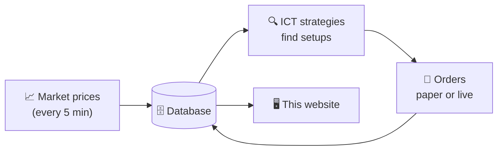
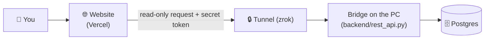

# Algo ICT Trader (Titania)

**A dashboard that finds ICT trade setups, tracks every trade, and explains each one in plain words.**

🔗 **Live site:** https://algo-ict-trader.vercel.app
📘 **Technical architecture:** [docs/ARCHITECTURE.md](docs/ARCHITECTURE.md)


---

## What it does, in one minute

1. **Collects prices.** Every 5 minutes, candles for US stocks (Dow 30), Indian stocks (NIFTY 50) and forex are saved to a database.
2. **Looks for setups.** ICT strategies scan those candles for patterns: liquidity sweep → market structure shift → entry at an order block / fair value gap.
3. **Places and tracks trades.** A setup becomes an order — on paper, or live with a broker (OANDA, Indian brokers). Each trade is followed until it hits its target or its stop.
4. **Shows everything here.** This website shows every signal, every trade, the result in "R" (risk units), charts, and statistics.



---

## Picture tour

### 1. Pick what you want to see, then press **Run**

Choose market, ticker, strategy, direction, dates and more. Nothing loads until you press **Run**; after that it refreshes every 30 seconds.


### 2. The scorecard

Right under the filters, **Filtered decision snapshot** sums up the trades you selected:

| Box | Meaning |
|---|---|
| Signals / Closed sample | How many setups were found / how many trades finished |
| Win rate | % of finished trades that made money |
| Profit factor | Money won ÷ money lost (above 1 = profitable) |
| Net result / Expectancy | Total R earned / average R per trade |
| Max drawdown | Worst losing stretch, in R |

### 3. The signal & order feed — click any row

Every setup is one row: time, ticker, strategy, side (BUY/SELL), entry, stop, targets, result. **Click a row** to open its charts right below.


### 4. "Click me for a detailed explanation of this trade"

A gold bar appears above the charts. Click it to read, in plain words:
- **Why** the trade was taken (the ICT sequence, when it was recorded),
- **The plan** — entry, stop, targets and their R,
- **What happened** — outcome, exit price and reason.

It only uses facts saved with the trade, nothing is guessed.


### 5. The trade on the chart

The 5-minute execution chart (left) shows entry, stop, targets and the ICT zones (FVG, order blocks, liquidity). The higher-timeframe chart (right) shows the Daily / 1H / 30m / 15m picture.


### 6. Backtest — how a strategy did in the past

Pick a strategy and press **Run** to see profit, win rate, drawdown, equity curve and every historical trade.


### 7. Other research tabs

| Tab | What it shows |
|---|---|
| **Reversal** | Trend-reversal setups (paper + OANDA live) |
| **Daily Bias** | For each day: was it an expansion, retracement, reversal or consolidation day? |
| **Consolidation / Expansion / AMD** | Range, breakout and Accumulation-Manipulation-Distribution research |
| **Machine Learning** | Model scores that rate each setup's risk |


---

## How the live website gets its data

The database lives on the owner's PC. The website on Vercel reaches it through a secure, **read-only** bridge:



- The bridge only allows **reading** — it cannot change or delete anything.
- The PC must be on for live data.
- **Account Management** (real broker balances) is hidden on the public site.

---

## Run it yourself

```bash
npm install
npm run dev        # http://localhost:3000
```

Set `DATABASE_URL` (or `POSTGRES_HOST`, `POSTGRES_DATABASE`, `POSTGRES_USER`, `POSTGRES_PASSWORD`) to your Postgres. See [docs/ARCHITECTURE.md](docs/ARCHITECTURE.md) for the full system: cron jobs, broker connections, tables and deployment.

> ⚠️ Research and paper-trading software. Not financial advice.
