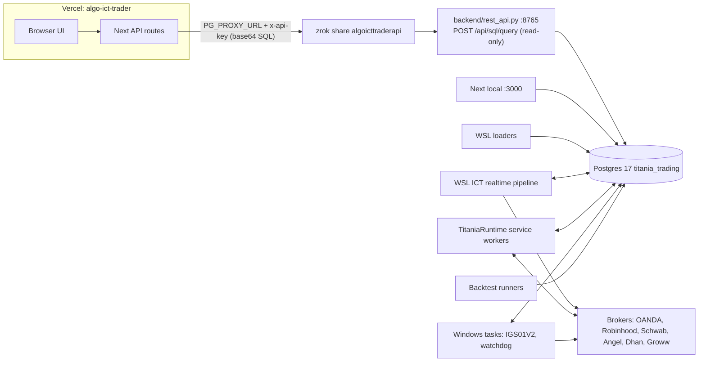
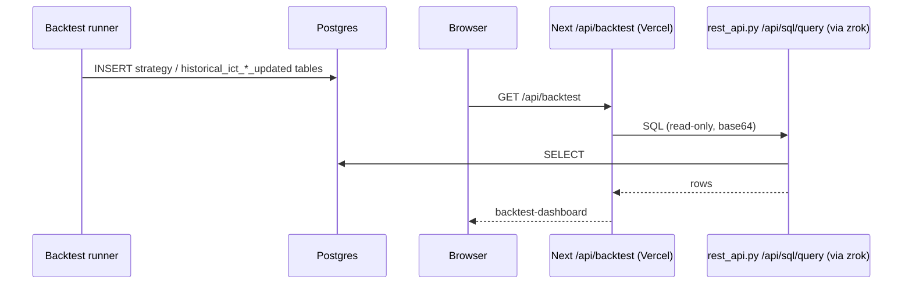
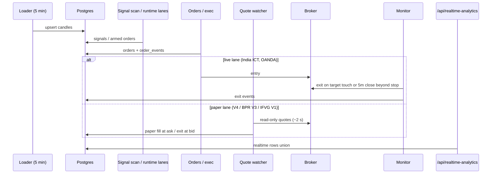

# Titania / Algo_ICT_Trader — Software Architecture

_Last updated 2026-11-03. Read-only review of the code on REDDY786; the database was not queried (schema from code and `DATABASE_TABLES_GUIDE.md`). Items marked **(inferred)** are conclusions, not observed._

Path roots: `ATR/` = this repo (`OneDrive\Documents\Algo_ICT_Trader`), `ICTA/` = `Desktop\ICT_Automation`, `TCS/` = `Desktop\Titannia-Cronjob-scripts`.

## 1. Overview

One workstation, one Postgres hub (`titania_trading`).

- **Loaders** (WSL cron) write candles.
- **Strategy engines** (WSL cron, Windows service `TitaniaRuntime`, Windows tasks) produce signals → orders → paper or broker executions.
- **Backtest runners** (`ICTA/Backtesting_ICT_2017`, `ATR/scripts`, `*_publish.py`) write result tables.
- **Next.js 16 site** (`ATR/src`) reads everything: direct Postgres locally; on Vercel through the read-only SQL proxy on the REST bridge, exposed by zrok.

## 2. Frontend

- `src/app/page.tsx` → `components/trading-landing.tsx`: single-page app with tab state; default tab `realtime-orders`; `?tab=` deep links.
- **Account Management is hidden on Vercel** by two flags: `NEXT_PUBLIC_HIDE_ACCOUNT_MGMT=true` (removes the tab) and `HIDE_ACCOUNT_MGMT=true` (`src/proxy.ts` returns 404 for `/api/account-management/*`). Unset locally.
- `isAuthed` starts as `true`; there is no real login. The production URL is public.
- **Realtime Orders** (`components/realtime-orders-dashboard.tsx`): filters → Decision snapshot → **Realtime ICT Signal & Order Feed** → clicked row's charts (trade explanation, 5m execution chart, HTF chart, option legs, replay) → analytics.
  - `components/trade-explanation.tsx`: "Click me for a detailed explanation of this trade" — built only from the stored row and `strategy_json` (sweep, MSS, entry array, trigger, plan, outcome).
  - Hovering a feed row prefetches its chart data (`src/lib/fetch-cache.ts`).

## 3. Data access

- `src/lib/db.ts` returns one `pg.Pool`-compatible object:
  - **Vercel:** `PG_PROXY_URL` + `PG_PROXY_TOKEN` set → every query is POSTed (base64 envelope) to `POST /api/sql/query` on the bridge. `BEGIN/COMMIT/ROLLBACK/SET LOCAL` become no-ops; date/timestamp columns are rebuilt as `Date`, int8/numeric stay strings (same as node-pg).
  - **Local:** `DATABASE_URL`/`POSTGRES_URL`, or `POSTGRES_HOST/DATABASE/USER/PASSWORD/PORT`.
- Some routes still contain an older per-route bridge path when `CANDLES_REST_API_URL` is set. That variable is **removed** on Vercel, so all routes use the single proxy path and match local results.
- **Bridge** `backend/rest_api.py` (Flask, served by waitress in `backend/serve.py`, 16 threads, `127.0.0.1:8765`):
  - `/api/sql/query`: requires `ALGO_API_TOKEN` (refuses if unset), read-only connection pool (max 16), 60 s statement timeout, `$n` → psycopg2 params.
  - zrok's public frontend blocks some raw SQL patterns, hence the base64 envelope.
- **Caching:** chart endpoints (`order-chart`, `daily-forward`, `daily-bias/replay`) send `Cache-Control: public, s-maxage=60, stale-while-revalidate=600` (`next.config.ts`); the browser also caches them for 60 s.

## 4. Services — what runs where

### Website side (Windows)

| Service | Start | Notes |
|---|---|---|
| REST bridge | `scripts/start-rest-api.ps1` | Manual; no service/task yet |
| zrok tunnel | `scripts/start-zrok-share.ps1` → `https://algoicttraderapi.share.zrok.io` | Manual |
| Titania Assistant | `uvicorn backend.titania_assistant.main:app --port 8100` | OpenRouter/Ollama, LangSmith, SQLite RAG |
| Next.js | `npm run dev` / `start` on :3000 | Next 16.2.10, React 19.2.4 |

### WSL cron (America/New_York)

- `TCS/titania_postgres_loader_production.py`: US every 5 min on weekdays; India at :02/:17/:32/:47 during 00–05 ET.
- HTF prep 22:00 (India) and 08:30 (US); LTF strategy uploads; `orders_monitoring_postgres_final.py` every 30 min.
- **ICT realtime US:** `htf_update_once.py us` 08:30; `ICT_Cron_Setup/us/run_realtime_cycle.sh` every 5 min 09:30–16:00.
- **ICT realtime India:** `htf_update_once.py india` 23:00; `india/run_pipeline.sh` every 5 min; `run_1m_order_monitor.sh` every minute.
- Broker-truth sync India: `broker_truth_sync_india.sh`.
- Robinhood: only `monitor_positions.py` is scheduled; `run_ict_cycle.py --live` is not in the active crontab (inferred: no new RH entries).

### Windows service `TitaniaRuntime`

`ICTA/realtime_execution/RUNTIME_ARCHITECTURE.md`, `runtime/registry.py`. Depends on `postgresql-x64-17`; status on `127.0.0.1:8789`; DB budget ≤ 40 connections.
Jobs: forex ingest/repair, refresh-us/forex, minute-feed, reversal-us/forex (paper), OANDA practice entry/monitor, scalping V4 / BPR / IFVG (paper), quote-contracts, quote-watch (2 s, paper), scalping-stops, option-tape, notifications, digest. Matching Windows tasks are disabled rollback copies — never run both.

### Quote watchers (stay local)

`scalping_quote_watcher.py` (paper, ~2 s). `runtime/hybrid_quotes.py`: Schwab streaming first, Robinhood for missing symbols. Schwab refresh token lasts 7 days and needs an interactive login.

### Brokers

| Broker | Role |
|---|---|
| OANDA practice | Reversal k1 1H, IGS01V2 (killzone scan, hourly reconcile) |
| Robinhood | US options entries/monitor; quote fallback |
| Schwab | Market data only |
| Angel One / Dhan / Groww | India live entries/exits; broker_sync for truth |

## 5. Database (main groups)

| Tables | Producer | Consumer |
|---|---|---|
| `candles_*` | TCS loaders | All charts, signal scan, executors |
| `historical_candles_*` | Backtest ingest, forex collectors, Barchart history | Backtest charts, SMT, weekly profile |
| `realtime_production_ict_*`, `_orders`, `_order_events`, `_broker_order_*` | HTF/LTF scan, order monitors, India executors | Realtime Orders, Live, ML |
| `realtime_production_mss_reversal_*`, `_reversal_k1_*`, `reversal_k1_live_orders` | Reversal engines, OANDA live | Realtime Orders, Reversals |
| Scalping V4/BPR/IFVG orders + option legs | Runtime lanes, quote watcher | Realtime analytics, option charts |
| `realtime_production_broker_*`, `oanda_account_*` | `scripts/broker_sync/*`, `oanda_sync.py` | Account Management (local only) |
| `historical_ict_*`, `s16v2_*`, `s01v2/v3_*`, `scalping_*` | Backtest runners/publishers | Backtest tab |
| `reversal_*`, `amd_*`, `consolidation_*`, `expansion_*` | Research engines | Matching tabs |

Rule (`DATABASE_TABLES_GUIDE.md` §10): `*_strategy_met_execution` = signals, `*_orders` = state, `*_order_events` = audit, Discord = presentation.

## 6. Deployment

| Component | Where | Env var names |
|---|---|---|
| Next.js | Vercel `algo-ict-trader` | `PG_PROXY_URL`, `PG_PROXY_TOKEN`, `NEXT_PUBLIC_HIDE_ACCOUNT_MGMT`, `HIDE_ACCOUNT_MGMT` |
| Next.js | Local :3000 | `DATABASE_URL` or `POSTGRES_*`, `BROKER_LIVE_*`, `MSS_PYTHON`, `REPORTS_DIR`, `SCHWAB_*` |
| REST bridge | 127.0.0.1:8765 | `ALGO_API_TOKEN` (from `backend/api-token.local`), `POSTGRES_*`, `PORT` |
| zrok | PC | reserved share `algoicttraderapi` |

Deploy: `vercel deploy --prod` from the repo root. `.vercelignore` excludes `.env*`, `backend/`, scratch folders and two >100 MB consolidation CSVs.

Not available on Vercel: tabs that spawn Python (Market Structure Shift, Scalping Labs charts/backtest), local report files, and the live broker snapshot.

## 7. Data flows

### Backtest → dashboard

### Realtime signal → order → dashboard

## 8. Risks and single points of failure

1. **One workstation** runs Postgres, every strategy, the bridge, the tunnel and the tokens. Sleep, reboot or an outage stops everything, including the Vercel site's data.
2. **Bridge and zrok are started by hand** — no service or health alert yet.
3. **Postgres connections:** `max_connections` 100; the runtime caps itself at 40, the proxy pool adds up to 16; cron, Streamlit and backtests are outside any budget.
4. **Schwab refresh token** every 7 days (interactive); Robinhood OAuth can't renew in the background.
5. **No site authentication** — the production URL is public (paid Vercel plan planned for password protection).
6. **Secrets in files:** `.env.example` (untracked) appears to hold a real `LANGSMITH_API_KEY` — rotate it; default DB password in `scripts/start-rest-api.ps1`; token files under OneDrive/Desktop.
7. Crontab drift vs reference files; no schedule found for `oanda_sync.py`; Angel/Groww day books are unrecoverable if a sync day is missed; India cron times shift with US DST.
8. Disabled Windows tasks alongside TitaniaRuntime — re-enabling them causes double execution.
